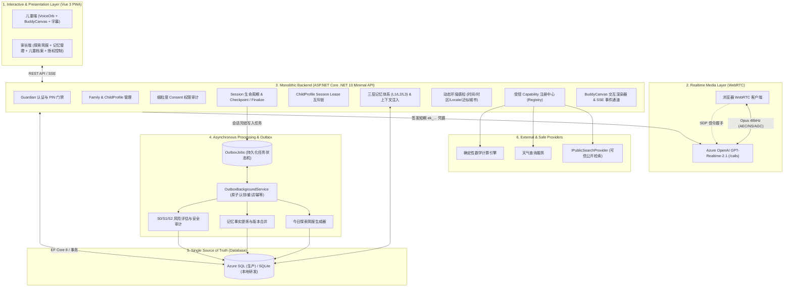

# Phase 1 Target System Architecture

**项目名称：** AI Buddy  
**架构版本：** 1.0 (Phase 1 Baseline)  
**设计目标：** 长期陪伴、跨设备记忆、环境感知、受控工具调用与儿童安全体系  

---

## 一、六层系统架构拓扑

---

## 二、核心架构准则

1. **单体自洽，杜绝过度架构**：
   - 维持 Vue 3 PWA + ASP.NET Core .NET 10 单体。
   - 严禁引入微服务集群、Kubernetes、Redis、Kafka、RabbitMQ、向量数据库等高运维负担组件。
   - 异步任务与可靠调度全量基于数据库事务 + Outbox 模式。

2. **长期记忆与实体边界**：
   - **1 个 ChildProfile = 1 个长期 AI 记忆身份**。
   - **1 个 Device = 1 个物理使用入口**（DeviceId 不作为记忆主体）。
   - **1 个 Session = 1 次独立实时通话**。
   - 同一 ChildProfile 的所有授权设备共享唯一的长期记忆库（SSOT 为数据库）。

3. **双通道协作与媒体分离**：
   - 音频媒体：浏览器与 Azure WebRTC 保持直连，享受 <750ms TTFS 的超低时延。
   - 信令与业务：ASP.NET Core 负责签发凭证、校验授权、管理租约、持久化转写与执行工具调用。

4. **动态 Context 与长期 Memory 严格隔离**：
   - 动态 Context：当前 UTC 时间、设备本地时间、IANA 时区、经授权的城市信息，仅在通话期临时注入。
   - 长期 Memory：明确表达的兴趣、已确认的事实、待续话题；严禁将临时 GPS/时间持久化为儿童人格标签。

5. **BuddyCanvas 确定性安全原则**：
   - 模型只能生成严格符合预定义 Schema 的 JSON 结构。
   - 前端采用白名单组件渲染（`KnowledgeCard`, `MultipleChoiceQuiz`, `FlashCards`, `InteractiveStory`），绝不执行任意动态 HTML/JavaScript。
