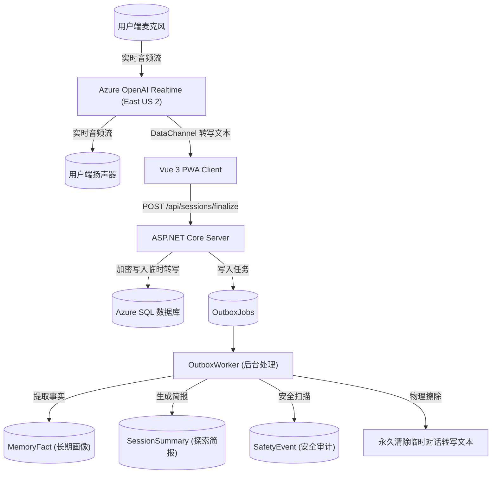

# Phase 1 Data Classification & Retention Specification

**项目名称：** AI Buddy  
**数据保护基准：** 中国大陆《个人信息保护法》儿童专章 / GDPR 儿童合规最佳实践  
**核心原则：** 最小化采集、端侧不存敏感音频、云端安全脱敏、按权限隔离  

---

## 一、数据分类与等级划分

| 数据资产类别 | 字段内容示例 | 敏感级别 | 存储介质 | 加密与脱敏规范 | 默认留存期 |
|---|---|:---:|---|---|---|
| **C1. 账户与认证数据** | Guardian 标识、密码盐、PIN Hash | **高** | 数据库 | PBKDF2/BCrypt 加密，严禁明文 | 账号注销后物理删除 |
| **C2. 儿童档案数据** | 昵称、年龄段、偏好音色、语言 | **中** | 数据库 | 仅限家庭内部成员授权访问 | 档案删除时物理删除 |
| **C3. 设备与凭证** | DeviceId、WebRTC 临时凭证 `ek_...` | **中** | 内存 / 数据库 | `ek_...` 仅生命周期 10~600s，不落盘 | 临时凭证过期自毁 |
| **C4. 原始语音媒体** | 麦克风 PCM/Opus 实时音频流 | **极高** | **不持久化** | 内存流式解码，不落数据库、不落磁盘 | **0 秒**（端到端零持久化） |
| **C5. 会话临时转写** | 乱序整理后的对齐文本、item_id | **高** | 数据库 (临时表) | 字段级 AES 加密，任务处理完毕即删 | **最多 24 小时**（出箱提炼后销毁） |
| **C6. 长期结构化记忆** | MemoryFact (兴趣/事实标签) | **中** | 数据库 | 家长端可查看、可编辑、可撤销 | 手动删除或 180 天未复核衰减 |
| **C7. 今日探索简报** | 好奇心闪光点、亲子互动建议 | **低** | 数据库 | 结构化脱敏，不含原始对话原文 | 建议保留 30 天 |
| **C8. 儿童安全事件** | SafetyEvent (S1/S2 风险预警证据) | **极高** | 数据库 (受限审计表) | 强权限隔离，仅限核身监护人访问 | 依照当地未成年人保护要求受控保存 |
| **C9. 动态环境上下文** | 客户端 UTC、时区、城市、计算参数 | **低** | 仅会话内存 | 绝不持久化为儿童长期标签 | 会话结束后销毁 |

---

## 二、数据流向图 (Data Flow Diagram)

---

## 三、删除与注销流程 (Right to be Forgotten)

1. **单条记忆删除**：家长端在 MemoryManagement 界面点击删除特定事实标签，该条记录立即标记 `IsActive = false`，且从下一次 Session 的记忆上下文中彻底排除。
2. **儿童档案注销**：注销 ChildProfile 时，级联删除该儿童名下所有关联记忆、历史简报、安全事件与会话记录。
3. **撤回授权删除**：当监护人撤回“跨会话记忆”或“今日简报”授权时，系统自动触发后台任务批量清空已提炼的记忆与简报数据。
