# Phase 1 Entity Relationship Diagram (ERD) & Database Specification

**项目名称：** AI Buddy  
**数据持久化策略：** Azure SQL (生产) / SQLite (本地开发与快速测试)  
**ORM：** EF Core 10 / 8 (Code First + Migrations)  

---

## 一、实体关系模型 (Mermaid ERD)

```mermaid
erDiagram
    Family ||--|{ Guardian : "has"
    Family ||--|{ ChildProfile : "owns"
    Family ||--|{ DeviceBinding : "registers"
    
    Guardian ||--o{ ConsentRecord : "grants"
    
    ChildProfile ||--o{ Session : "participates"
    ChildProfile ||--o{ MemoryFact : "accumulates"
    ChildProfile ||--o{ SessionSummary : "has_digests"
    ChildProfile ||--o{ ChildSessionLease : "holds_active_lease"
    ChildProfile ||--o{ SafetyEvent : "flags"

    DeviceBinding ||--o{ Session : "initiates"

    Session ||--o{ ToolInvocation : "records"
    Session ||--o{ BuddyActivity : "spawns"
    Session ||--o{ OutboxJob : "triggers"

    Family {
        guid Id PK
        string Name
        string Status
        datetime CreatedAtUtc
        datetime UpdatedAtUtc
    }

    Guardian {
        guid Id PK
        guid FamilyId FK
        string SubjectIdentifier "手机号/邮箱/统一ID"
        string DisplayName
        string Role "Owner/Parent"
        string PinHash "BCrypt/PBKDF2 6位PIN"
        int FailedPinAttempts
        datetime LockoutEndUtc
        datetime CreatedAtUtc
    }

    ChildProfile {
        guid Id PK
        guid FamilyId FK
        string Nickname
        string AgeBand "4-6, 7-8, 9-10"
        string PreferredVoice "marin, cedar, alloy"
        string LanguagePreference "zh-CN"
        int CurrentMemoryVersion
        boolean IsActive
        datetime CreatedAtUtc
        datetime UpdatedAtUtc
    }

    DeviceBinding {
        guid Id PK
        guid FamilyId FK
        guid BoundChildProfileId FK
        string DeviceId "客户端指纹/UUID"
        string DeviceName "iPad / 家长iPhone"
        string Platform "iOS/Android/Desktop"
        boolean IsAuthorized
        datetime LastActiveAtUtc
        datetime CreatedAtUtc
    }

    ConsentRecord {
        guid Id PK
        guid GuardianId FK
        guid ChildProfileId FK
        string ConsentType "Voice, Memory, Digest, Transcript, Location, WebSearch"
        string Version "1.0"
        boolean IsGranted
        datetime GrantedAtUtc
        datetime RevokedAtUtc
    }

    Session {
        guid Id PK "ApplicationSessionId"
        guid FamilyId FK
        guid ChildProfileId FK
        guid DeviceBindingId FK
        string AzureSessionId
        string AzureCallId
        string Mode "adult/child"
        string Status "Active, Finalized, Abandoned, Error"
        int DurationSeconds
        int MemoryVersionAtStart
        boolean TranscriptConsentSnapshot
        string StructuredTranscriptJson "临时加密转写"
        datetime StartedAtUtc
        datetime EndedAtUtc
        datetime CheckpointedAtUtc
    }

    ChildSessionLease {
        guid ChildProfileId PK, FK
        guid ActiveSessionId FK
        guid DeviceBindingId FK
        string HeartbeatToken
        datetime LeaseExpiresAtUtc
        datetime AcquiredAtUtc
    }

    MemoryFact {
        guid Id PK
        guid ChildProfileId FK
        string FactType "Interest, Preference, Habit, OpenQuestion"
        string Content
        guid SourceSessionId FK
        string SourceType "child_explicit, guardian_provided, model_inferred"
        float Confidence
        int MemoryVersion
        boolean IsActive
        datetime CreatedAtUtc
        datetime LastConfirmedAtUtc
        datetime ExpiresAtUtc
    }

    SessionSummary {
        guid Id PK
        guid SessionId FK
        guid ChildProfileId FK
        string TopicsJson
        string CuriosityHighlight
        string FamilyActivitySuggestion
        string NextTopicsJson
        string ExpressedFeelings
        datetime GeneratedAtUtc
    }

    OutboxJob {
        guid Id PK
        string JobType "ProcessSessionFinalize, GenerateDigest, ExtractMemory, AuditSafety"
        string PayloadJson
        string Status "Pending, Processing, Completed, Failed"
        int RetryCount
        int MaxRetries
        string LockInstanceId
        datetime LockedUntilUtc
        string LastError
        datetime CreatedAtUtc
        datetime UpdatedAtUtc
    }

    SafetyEvent {
        guid Id PK
        guid ChildProfileId FK
        guid SessionId FK
        string Severity "S0, S1, S2"
        string Category "Bullying, HarmRisk, Distress, Other"
        string ContextEvidence
        string ResolutionNotes
        boolean IsAcknowledgedByGuardian
        datetime DetectedAtUtc
    }

    BuddyActivity {
        guid Id PK
        guid SessionId FK
        string Kind "KnowledgeCard, Quiz, FlashCard, Story"
        string Title
        string SchemaVersion
        string PayloadJson
        string UserResponseJson
        datetime SpawnedAtUtc
        datetime RespondedAtUtc
    }

    ToolInvocation {
        guid Id PK
        guid SessionId FK
        string ToolName
        string InputJson
        string OutputJson
        boolean IsSuccess
        int DurationMs
        datetime InvokedAtUtc
    }
```

---

## 二、表设计规范与索引优化

1. **多租户隔离与外键级联**：
   - 每一个关键实体均通过 `FamilyId` 或 `ChildProfileId` 进行逻辑隔离。
   - 所有服务层读取强制追加 `WHERE FamilyId = @CurrentFamilyId` 过滤条件。
2. **索引规划**：
   - `ChildProfile (FamilyId, IsActive)`
   - `Session (ChildProfileId, Status, StartedAtUtc)`
   - `MemoryFact (ChildProfileId, IsActive, FactType)`
   - `OutboxJob (Status, LockedUntilUtc, RetryCount)`：保障 BackgroundService 毫秒级领取。
   - `ChildSessionLease (LeaseExpiresAtUtc)`：保障并发争抢与过期清理。
