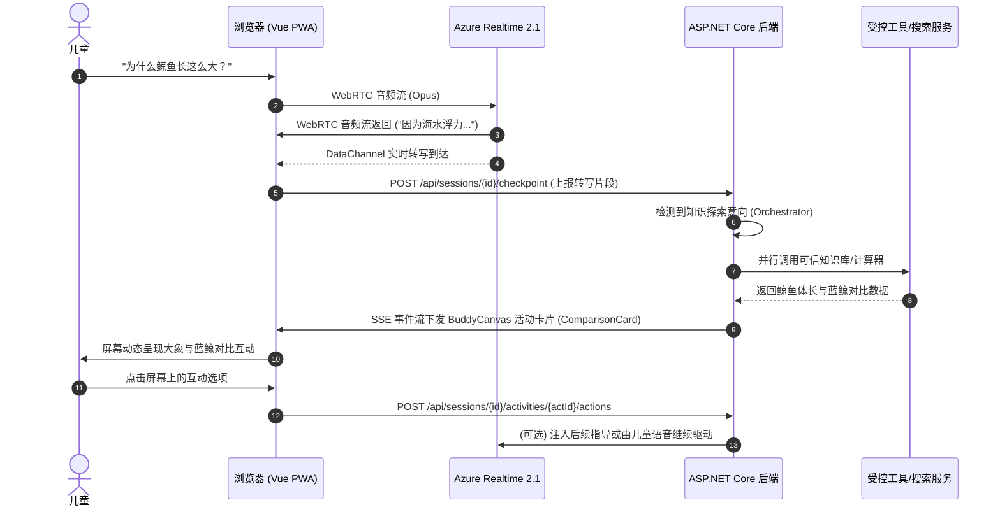

# Phase 1 Realtime Function Calling & Signaling Architecture POC (Gate 0.5)

**项目名称：** AI Buddy  
**验证课题：** GPT-Realtime-2.1 WebRTC 工具调用链路可行性与信令中继方案  
**评估结论：** 双通道解耦方案具备最高工程可靠性与最低端侧改造风险  

---

## 一、技术验证背景与协议边界

在 Phase 0 中，AI Buddy 采用“浏览器端直接通过 WebRTC 与 Azure `/calls` 建立媒体与 DataChannel 交互”的架构。
在引入工具调用 (Function Calling) 与动态互动卡片 (BuddyCanvas) 时，客观面临两个核心架构约束：
1. **Azure WebRTC `webrtcfilter=on` 白名单约束**：
   - 在开启过滤时，WebRTC DataChannel 仅透传已授权的 11 类核心事件（如语音开始/结束、音频转写、打断等）。非白名单事件无法通过端侧 DataChannel 安全双向直达。
2. **纯前端执行工具的合规与安全漏洞**：
   - 严禁将数据库凭据、外部搜索引擎 API Key 暴露给前端。
   - 严禁允许前端绕过监护人授权直接触发外部能力。

---

## 二、候选架构对比与 POC 结论

| 维度 | 方案 A: SDP 代理与服务端 Sideband | 方案 B: 浏览器受控中继 (Client Relayed) | 方案 C: 双通道解耦 (Realtime Audio + Server SSE) |
|---|---|---|---|
| **信令流向** | 浏览器 ⇄ 后端代理 ⇄ Azure | 浏览器 ⇄ Azure / 浏览器 ⇄ 后端 | 语音直连 Azure，UI 与工具走后端 SSE/HTTP |
| **媒体延迟** | 增加单跳代理延迟风险 | 直连最优 (<750ms) | 直连最优 (<750ms) |
| **实现复杂度** | 极高（需在 .NET 中维系高并发 WebRTC/SDP/WebSocket 桥接） | 中等（需客户端处理工具请求中转） | 优雅适中（现有架构自然延伸） |
| **容错与降级** | 代理挂死则语音全挂 | 工具失败不影响语音正常交谈 | 工具失败或卡顿完全不影响实时语音 |
| **推荐评级** | 候选评估 | 备选方案 | **推荐首选基线 (Recommended Baseline)** |

---

## 三、方案 C（推荐路线）的工程落地拓扑

### 3.1 方案优势
1. **完全保全 Phase 0 的极限低时延**：无需承担服务端转发媒体流的巨大网络与 CPU 开销。
2. **渐进式演进**：即使网络波动导致 BuddyCanvas 卡片稍晚呈现，儿童与 Buddy 的实时语音交谈完全不卡顿、不断流。
3. **安全合规无缝集成**：所有外部搜索、工具调用全量发生在 ASP.NET Core 服务端，完全受控于 `ConsentRecord`。
