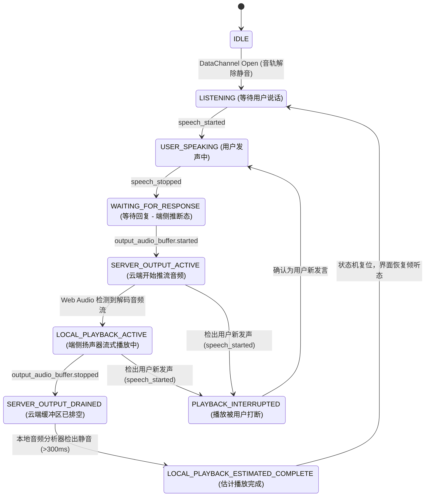
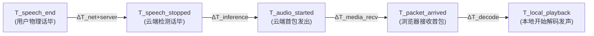

# AI Buddy — Phase 0 技术评估与实施方案（完整修订版 v3.0）

> **版本定位**：v3.0 是正式进入 Gate 1 完整多轮语音应用工程实现的权威技术方案。本版本在 v2.9 基础上完成了最终的定点工程审查与勘误，确立了软件层音频播放估计状态机、打断后多层上下文一致性设计、基于 `getStats()` 的四段式真实 WebRTC 媒体度量体系、全链路异常兜底保障机制与严谨透明的数据合规规范，并正式启动 Gate 1 Vue 3 PWA 的端到端实现。

---

## 结论评级与验证声明规范

方案中所有关键技术结论均附带官方文档索引并严格归类为以下三级标准：
- **[官方明确支持]**：Microsoft 或 OpenAI 官方文档、官方 REST API Reference 中有明确文字规范与 Schema 定义。
- **[根据文档推断]**：基于官方协议逻辑、WebRTC RFC 标准或已公开官方 SDK 实现推导出的最佳工程实践。
- **[必须通过真实 Azure 资源验证]**：受限于订阅权限、动态配额、特定资源网关或官方文档版本差异，必须通过当前 Azure 订阅的真实代码探针与网络采集核实。**凡未经实测的项目，一律标记为“待验证”，严禁编造或主观推定**。

---

## 一、v2.9 → v3.0 核心技术勘误对照表

| 序号 | 议题 / 模块 | 优先级 | v2.9 原表述 | v3.0 修正结论 | 官方依据 / 真实验证方法 | 对实施的影响 |
| :---: | :--- | :---: | :--- | :--- | :--- | :--- |
| **1** | **音频播放状态机与物理发声** | **P0** | 将 Web Audio 振幅检出视为物理发声，且对播放完成的判定仍模糊。 | **确立五态软件估计模型**：定义 `SERVER_OUTPUT_ACTIVE`（云端开始推流）、`SERVER_OUTPUT_DRAINED`（云端缓冲区排空）、`LOCAL_PLAYBACK_ACTIVE`（端侧活跃解码播放）、`LOCAL_PLAYBACK_ESTIMATED_COMPLETE`（基于排空事件+静音检测的端侧估计完成）与 `PLAYBACK_INTERRUPTED`。明确此为**软件层播放完成估计**，非物理声学测量；持续存在的 WebRTC MediaStream 无法依靠 `<audio>.ended` 判定单轮结束；物理发声只能依靠外部声学仪器验证。 | Web Audio API & Media Capture Spec **[官方明确支持]** | 杜绝将服务端排空直接等同于用户听完，确保 UI 状态指示与轮次衔接符合声学物理事实。 |
| **2** | **打断与上下文一致性设计** | **P0** | 仅聚焦用户发声时 AI 停止播报，未剖析打断时多层内容脱节问题。 | **拆解打断四层内容边界**：清晰区分：1. 模型已生成 Token；2. 服务端已发音频；3. 浏览器已接收分片；4. 用户实际听到的内容。Gate 1 优先采用 Azure 原生打断（`interrupt_response: true`），严禁将“AI 停止发声”直接认定为“上下文已正确截断”。高阶截断 API（`conversation.item.truncate`）放入 Gate 2 深度研究。 | OpenAI Realtime API Spec **[官方明确支持]** | 避免对打断上下文同步进行虚假宣称，确立针对多轮打断后上下文连贯性的实测检验机制。 |
| **3** | **时延测量口径与统计方法** | **P0** | 曾使用初步 TCP RTT 推算 WebRTC 媒体传输延迟，并将 50 次样本视为充分统计。 | **彻底废除 TCP 推断，建立 `getStats()` 真实指标**：通过 WebRTC 原生统计采集 `currentRoundTripTime`、`packetsSent/Received`、`packetsLost`、`jitter`、`jitterBufferDelay`。时延拆分为信令、媒体网络、首音频生成、端侧播放四段独立度量。明确 30~50 次仅为初步摸底，正式 P50/P95 评估需采集 100~300 次样本并计算置信区间。 | W3C WebRTC 1.0 & Stats RFC 8829 **[官方明确支持]** | 建立严谨的统计学评价标准，杜绝偷换网络层概念。 |
| **4** | **儿童隐私与 Azure 真实留存边界** | **P0** | 易引起“应用端零存储即等于云端零数据留存”的误解。 | **如实披露云端处理真相**：明确 `tracing: null` 仅关闭 Realtime Session Tracing，**绝对不等于关闭 Azure Abuse Monitoring，也不等于 Zero Data Retention (ZDR)**。如实告知模型推理临时处理、Global 调度机房不固定性、以及应用端零录音、零转写持久化和日志脱敏的管辖边界。儿童正式上线前必须增加独立家长授权与适用地区合规审查。 | Microsoft Data, Privacy & Security for Azure OpenAI **[官方明确支持]** | 杜绝合规虚假宣称，落实透明告知与切实的工程防范。 |
| **5** | **生产模式全链路异常兜底** | **P1** | 假定过滤模式下发生错误时客户端一定能收到 DataChannel `error` 事件。 | **构建客户端非依赖型多级容错兜底**：DataChannel 过滤模式下不可依赖 `error` 信令。建立多层硬性监控：HTTP 握手失败检测、PeerConnection / ICE 状态失败检测、DataChannel 关闭检测、建连超时（10s）与首响应超时（5s）机制，确保异常时优雅提示并支持一键重连。 | RFC 8829 WebRTC Error Handling **[官方明确支持]** | 杜绝网络异常或握手失败时前端界面无提示假死。 |
| **6** | **Gate 1 范围聚焦与 Gate 2 扩展** | **P1** | 规划中偶有将复杂高阶特性提前带入 Gate 1 的倾向。 | **保持 Gate 1 极简克制**：Gate 1 首要目标是在桌面 Chrome/Edge 上跑通正式 Vue 3 PWA 与 ASP.NET Core 的 **5 分钟多轮中文语音对话、至少 10 轮交互、六维打断与回声消除**。Gate 2 进一步评测 30 分钟长聊、拟人度表现（是否过度反问、是否维持稳定人格）及移动端前台适配。 | 敏捷工程交付原则 **[根据文档推断]** | 集中兵力快速打通第一个可用于真实人机交流的正式产品版本。 |

---

## 二、官方文档、实际探针与待验证事项三维分类

为了维护技术档案的绝对严肃性，本方案将所有核心技术断言严格划分为三个来源域：

```
┌─────────────────────────────────┐   ┌─────────────────────────────────┐   ┌─────────────────────────────────┐
│     [官方明确支持] (Official)     │   │      [实际探针验证] (Empirical)   │   │      [仍需实测验证] (Pending)    │
│  - GA REST 端点与状态码规范       │   │  - client_secrets HTTP 200 返回 │   │  - 5 分钟连续 10 轮对话稳定性    │
│  - webrtcfilter 11 类白名单      │   │  - Probe-A (application/sdp) 201│   │  - 30~50 次及 100~300 次正式 TTFS│
│  - interrupt_response 打断机制  │   │  - Probe-B (multipart) 201      │   │  - 六维打断后的上下文一致性      │
│  - Location 返回 rtc_... Call ID│   │  - ICE connected & DC OPEN      │   │  - 扬声器 80% 音量下的硬件 AEC   │
│  - Abuse Monitoring 默认留存政策 │   │  - 单轮发声 (energy sum = 3886) │   │  - 会话逼近 60 分钟硬上限的表现  │
└─────────────────────────────────┘   └─────────────────────────────────┘   └─────────────────────────────────┘
```

---

## 三、软件层音频播放估计状态机设计

由于 WebRTC 传入的是持续活跃的 `MediaStreamTrack`，其 HTML `<audio>` 元素不会在单轮播报完毕时触发 `ended` 事件；同时云端 `output_audio_buffer.stopped` 仅代表服务端输出缓冲区排空，不能等同于用户已经听完。因此建立以下五态估计状态机：



> [!NOTE]
> **物理测量声明**：`LOCAL_PLAYBACK_ESTIMATED_COMPLETE` 是软件层依据“服务端已停止推流”与“端侧 Web Audio 分析器连续 300ms 检出低振幅底噪”共同判定的**软件完成估计**。扬声器实际物理声学发声与环境回声只能通过外部精密声学采集设备（如外置测量麦克风）进行独立度量。

---

## 四、打断机制与上下文一致性设计

### 4.1 打断四层内容边界剖析
当用户打断 AI 时，客观存在四个不同步的物理边界：
1. **模型已生成内容 ($C_{\text{model}}$)**：云端 LLM 推理生成的全部 Token（可能已生成 200 字）。
2. **服务端已发送音频 ($C_{\text{sent}}$)**：经 TTS 编码并通过 WebRTC 实际发出的音频（约发出了 100 字）。
3. **浏览器已接收音频 ($C_{\text{recv}}$)**：在网络套接字与解码缓冲区中排队的音频（约收到了 95 字）。
4. **用户实际听到的内容 ($C_{\text{heard}}$)**：扬声器物理发声、用户大脑实际感知的片段（可能仅听到了 30 字即被打断）。

### 4.2 Gate 1 上下文一致性设计原则
- **避免过度工程化**：Gate 1 坚决不引入复杂的毫秒级音频对齐截断系统，优先采用 Azure 原生 Server VAD 打断：
  ```json
  "turn_detection": {
    "type": "server_vad",
    "threshold": 0.5,
    "prefix_padding_ms": 300,
    "silence_duration_ms": 500,
    "create_response": true,
    "interrupt_response": true
  }
  ```
- **关键认知**：**“AI 扬声器停止发声”绝不等于“云端上下文已被精确截断至用户打断点”**。云端模型在默认打断下，会将当前轮次标记为取消或部分截断，但不保证截断点精准落在用户听到的那一毫秒。
- **Gate 1 实测检验重点**：在用户打断后，测试下一轮对话 AI 是否能准确理解用户打断时提出的新指令（例如用户打断长句并提问：“等一下，你先告诉我天气怎么样？”），验证 AI 是否优先回答天气，而非固执重复之前未讲完的话题。
- **Gate 2 进阶项**：在多轮实测发现上下文出现偏差时，再深入研究 `conversation.item.truncate` 与精准播放时间戳对齐。

---

## 五、基于 `getStats()` 的四段式真实 WebRTC 媒体度量体系

彻底废止任何使用 TCP RTT 推算 WebRTC 媒体传输的结论。系统必须使用标准 W3C `RTCPeerConnection.getStats()` 读取真实的媒体层底层指标：



### 5.1 采集指标清单
1. **活跃候选对网络表现**：
   - `selectedCandidatePairId` 对应的 `currentRoundTripTime`（真实 UDP/DTLS 媒体往返时延）。
   - `availableOutgoingBitrate`（本地上行可用带宽估计）。
2. **音频下行 (inbound-rtp)**：
   - `packetsReceived`, `bytesReceived`（持续增长率）。
   - `packetsLost`（下行丢包数）。
   - `jitter`（媒体包抖动，毫秒）。
   - `jitterBufferDelay`（抖动缓冲区排队延迟）。
3. **音频上行 (outbound-rtp)**：
   - `packetsSent`, `bytesSent`（持续增长率）。

### 5.2 统计抽样阶段规范
- **第一阶段（初步摸底，Gate 0.5/1 期间）**：采集 **30 ～ 50 次** 有效交互样本，记录粗粒度分布与抖动情况，严禁将此摸底结果宣称为标准 P95。
- **第二阶段（正式统计，Gate 2 期间）**：在固定网络、不同设备（PC、手机）及不同接入方式（Wi-Fi、蜂窝网络）下累计收集 **100 ～ 300 次** 样本，计算正式的 P50、P95 及 95% 置信区间。

---

## 六、Azure 真实数据处理边界与儿童合规声明

必须依据 Microsoft 最新公布的 *Data, Privacy, and Security for Azure OpenAI Service* 规范进行如实告知：

### 6.1 云端与应用端责任边界
1. **模型推理临时内存处理**：音频流在 Azure 计算节点内存中执行流式解码与生成，推理完毕后即从内存中释放。
2. **Global 部署调度物理区域**：使用 GlobalStandard 部署时，Azure 依据全球算力池动态调度。资源创建于 `East US 2` 仅代表初始管理接入点，不等于所有请求物理常驻在单一机房。
3. **Abuse Monitoring (平台默认安全审查)**：Azure 默认将请求 Prompt 与 Completion 加密缓存在受控存储中**最多保留 30 天**，仅用于检测恶意使用。
4. **Modified Abuse Monitoring (豁免审查审批制)**：符合特定资质的企业可向微软申请豁免，审批通过后方可关闭人工审查与 30 天留存。**该特权并非平台默认，亦非针对所有儿童应用自动开通**。
5. **Realtime Session Tracing**：会话配置显式声明 `"tracing": null`，可关闭 Realtime 会话事件的云端追踪。**但 `tracing: null` 绝不等于关闭 Abuse Monitoring，亦不等于 Zero Data Retention (ZDR)**。
6. **应用自身管辖边界**：由我方代码完全掌控：
   - 严禁在应用端持久化儿童原始语音切片；
   - 严禁在应用端长期保存完整对话转写；
   - 应用日志严密脱敏儿童个人身份信息 (PII)。
7. **正式上线前提**：产品在正式推向儿童前，必须完成独立的家长授权（Parental Consent）机制与适用司法管辖区（如 COPPA/GDPR-K）的儿童隐私合规专项审查。

---

## 七、生产模式全链路异常兜底与错误诊断

在 `webrtcfilter=on` 开启时，不能假定 DataChannel 一定能收到详尽的 `error` 事件。系统必须建立脱离 DataChannel 的多层异常防护体系：

| 故障场景 | 检出手段 | 客户端兜底与用户恢复机制 |
| :--- | :--- | :--- |
| **1. 凭证签发或 SDP 协商失败** | HTTP 状态码 $\ne$ 200/201 | 捕获 HTTP 错误，记录 `x-ms-request-id`，界面提示“连接初始化失败”，提供“重试”按钮。 |
| **2. ICE 协商失败** | `pc.oniceconnectionstatechange === 'failed'` | 停止推流，提示“网络打洞失败，请检查防火墙或网络代理”，自动清理资源。 |
| **3. WebRTC 媒体连接中断** | `pc.onconnectionstatechange === 'disconnected' / 'failed'` | 界面切换为“连接已中断”，保留最近字幕，弹出一键“重新建立会话”入口。 |
| **4. DataChannel 意外关闭** | `dc.onclose` | 触发清理流程，置状态为 `ended`。 |
| **5. 建连超时 (Connection Timeout)** | 点击“开始”后 **10 秒** 未达到 `connected` | 强制终止握手，提示“连接超时，云端服务未及时响应”。 |
| **6. 首次响应超时 (Response Timeout)** | 用户说话完毕后 **5 秒** 未收到 `output_audio_buffer.started` | 界面从“思考中”优雅提示“AI 正在组织语言，请稍候”，防止用户误以为死锁。 |
| **7. 用户主动挂断** | 用户点击“结束交谈” | 客户端主动关闭音轨、关闭 DataChannel、关闭 PeerConnection，向后端上报会话结束。 |

---

## 八、Gate 1 实际验收规范与实施计划

### 8.1 Gate 1 验收硬性指标
- **运行载体**：正式 Vue 3 PWA 主界面（`client/src/App.vue`）+ 本地 ASP.NET Core 服务（`server/Buddy.Api`）。
- **浏览器环境**：优先在桌面 Google Chrome 或 Microsoft Edge 验收通过。
- **测试标准**：
  1. 能够稳定建立 WebRTC 连接，麦克风音轨门控正常；
  2. 测试者使用自然中文与 AI 进行**至少 5 分钟连续多轮交谈**（完成不少于 10 轮有效问答）；
  3. 完成**六维打断测试**（中途打断、连续打断、回声抗扰、播毕发声、打断后续接、上下文一致性）；
  4. 完成**扬声器外放 (80% 音量)** 与 **佩戴耳机** 两种声学环境对比测试，浏览器原生 AEC 稳定，无自激啸叫；
  5. 验证正常结束通话与断线重连恢复流程。

### 8.2 Gate 2 进阶测试储备（不阻塞 Gate 1）
- 连续 30 分钟长聊与 20～30 轮深度讨论；
- 人格拟真度评价：AI 是否频繁重复、是否过度主动反问、能否维持稳定温暖性格；
- iOS Safari 与 Android 移动端前台语音体验适配；
- 儿童真实语音专项测试（经家长书面授权后开展）。
